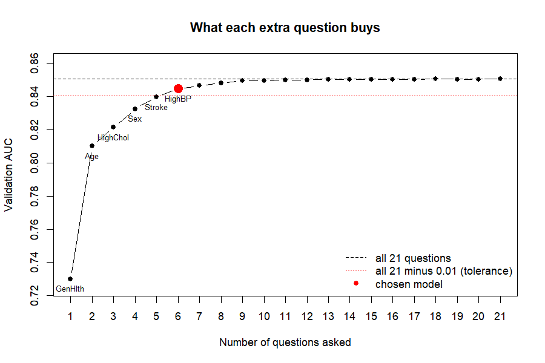
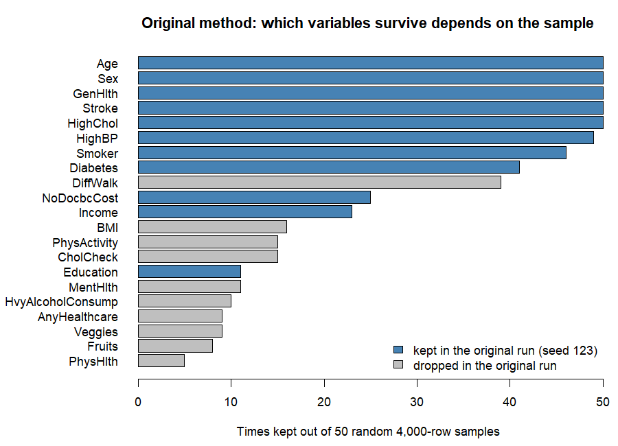

# The Cost of Complexity in Medical Triage: A Six-Question Heart Disease Score

**Author:** Max Chong, Imperial College London.

## Overview

A triage nurse has limited time per patient. This project asks how few of the 21 questions in the CDC Heart Disease Health Indicators survey a paper point score needs in order to separate people who report heart disease from those who do not, and how much is lost against a logistic regression using all 21.

The model is an additive logistic regression, chosen so that the result can be used by hand: each answer carries a fixed number of points, the nurse adds them up, and a patient whose total reaches the threshold is escalated. The comparison is therefore between question counts within that one kind of model. Whether a more flexible model would do better is not tested.

Complexity is counted in questions, because that is the nurse's cost. In model terms, six questions are 20 parameters and all 21 are 51.

The answer is a paper score sheet with six questions. On 50,738 held-out respondents it loses 0.006 AUC against the logistic regression using all 21 questions.

## Result

**Six questions:** general health, age, high cholesterol, sex, previous stroke, high blood pressure. The nurse adds up points and flags anyone scoring 18 or more out of 35. The sheet is in [`outputs/score_sheet.md`](outputs/score_sheet.md).



Held-out test set (50,738 respondents, 4,780 reporting heart disease):

| Model | Questions | AUC | 95% interval |
|---|---|---|---|
| Age only | 1 | 0.722 | 0.715 to 0.729 |
| **Point score** | **6** | **0.837** | **0.831 to 0.842** |
| Logistic regression | 6 | 0.837 | 0.832 to 0.843 |
| Logistic regression | 21 | 0.843 | 0.837 to 0.848 |

Flagging at 18 or more:

- **Workload:** 34.0% of people are flagged.
- **Cases caught:** 81.2% of people reporting heart disease (specificity 70.9%).
- **Among those flagged:** 22.5% report heart disease.
- **Cost of dropping 15 questions:** at the same share flagged, the 21-question model catches 82.2%, which is 49 more cases out of 4,780.

## Limitations

- **The outcome is self-reported history** of coronary heart disease or heart attack, recorded at the same time as the answers. The score finds people who resemble those already diagnosed. It has not been shown to find undiagnosed disease or to predict future disease.
- **Validation is internal.** Training and test rows come from the same 2015 United States telephone survey, not from a clinic.
- **Nearly one in five reported cases were missed.** At the 18-point cut-off, 900 of the 4,780 test respondents who reported a history of coronary heart disease or heart attack were left unflagged (18.8%).
- **Performance differs by age and sex.** The cut-off catches 37.9% of cases under 50 and flags 63.7% of everyone aged 65 and over. It catches 73.5% of cases among women and 86.8% among men.
- **The tolerance (0.01 AUC) and the sensitivity target (80%) are judgements.** The full curve and the table of every cut-off are in `outputs/` so that they can be changed.
- **Additivity is assumed.** Every model here gives each answer a fixed value regardless of the other answers. Whether a model allowing interactions would do better was not tested.

## Further work

- Benchmark the logistic regression against a flexible model such as gradient boosted trees, to measure what the additivity assumption costs.
- Validate against clinically confirmed diagnoses in a real triage population.
- Test age-specific cut-offs.

## Method

1. **Data:** all 253,680 rows, split 60/20/20 into training, validation and test sets, stratified on the outcome.
2. **Coding:** every question as categories, so that each answer can carry its own points.
3. **Question order:** forward selection of whole questions by AIC on the training set.
4. **Number of questions:** the smallest set whose validation AUC is within 0.01 of the 21-question model.
5. **Point score:** logistic regression coefficients scaled and rounded to integers. The scaling (0.25 log-odds per point) is the coarsest in a sweep that loses no more than 0.001 AUC on the validation set.
6. **Cut-off:** the highest score that flags at least 80% of cases on the validation set.
7. **Test:** one evaluation on the test set, with bootstrap intervals, calibration, and results by sex and age group.

## Why the first version was replaced

The original analysis (`archive/main.R`) used a random 4,000 rows, backward stepwise AIC and a likelihood ratio test. Repeating it on 50 different random samples of 4,000 rows gave 49 different sets of selected variables. It also never scored a prediction on unseen data.



## Reproducing

Requires R (4.6.2 used); no additional packages.

The dataset is not committed. Download the CDC Heart Disease Health Indicators dataset (BRFSS 2015, also on Kaggle) and place `heart_disease_indicators_dataset.csv` in the repository root, then run:

```
Rscript R/01_original_instability.R
Rscript R/02_coding_and_benchmarks.R
Rscript R/03_question_selection.R
Rscript R/04_final_model_and_score.R
```

Scripts 02 to 04 must run in that order. Script 03 takes about 30 minutes.

## Repository structure

- `R/00_utils.R`: data loading, recoding, the split, and metrics.
- `R/01_original_instability.R`: repeats the original method on 50 samples.
- `R/02_coding_and_benchmarks.R`: coding comparison and benchmark models on the validation set.
- `R/03_question_selection.R`: question order, the cost-of-complexity curve, and stability across training subsets.
- `R/04_final_model_and_score.R`: point score, cut-off, and the test-set evaluation.
- `outputs/`: result tables, figures and the score sheet (run logs and `.rds` intermediates are not committed).
- `archive/`: the original script and its output.
- `heart_disease_indicators_dataset.csv`: the dataset (not committed; see Reproducing).
